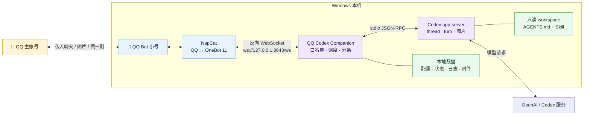
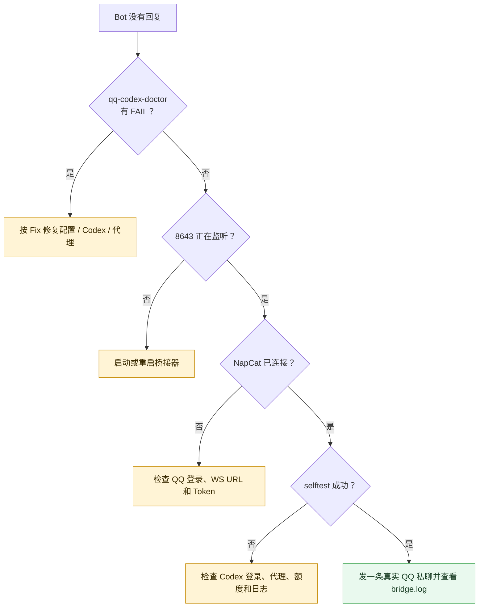

# QQ Codex Companion

<div align="center">

**Windows 原生、隐私优先的 QQ 私人陪伴机器人**<br>
通过 NapCat / OneBot 11，把 QQ 私聊连接到本机 Codex workspace。

[](https://github.com/need-to-find-name/qq-codex-companion/actions/workflows/ci.yml)


[](LICENSE)

[快速部署](#从零部署) · [运行架构](#工作原理) · [故障排查](#诊断与故障排查) · [配置参考](#完整配置说明) · [参与贡献](CONTRIBUTING.md)

</div>

QQ Codex Companion 不试图成为群管理平台或万能 QQ Agent。它专注于一件事：让你用一个 QQ 小号，获得自然、低打扰、可长期运行的一对一 Codex 对话体验。

| 🪟 Windows 原生 | 🔒 隐私优先 | 💬 自然陪伴 | 🌤️ 双向主动 |
| --- | --- | --- | --- |
| 无需 Docker、WSL 或 AstrBot | 白名单私聊、回环监听、默认只读 | 自然分条、图片、GIF、戳一戳 | 限频问候、天气、生活图片 |

### 一分钟了解它的特点

| 设计选择 | 本项目的做法 | 带来的价值 |
| --- | --- | --- |
| 使用场景 | 聚焦一个 Bot 小号与少量白名单用户的私聊 | 不为群管理牺牲私人陪伴体验 |
| 对话风格 | 轻消息优先一条，需要时才自然展开 | 减少“每句话都认真写小作文”的 AI 感 |
| 主动联系 | 时间窗、空闲间隔、概率和每日上限共同控制 | 有双向感，但不轰炸、不在半夜打扰 |
| 权限边界 | `read-only` + `never`，普通聊天不执行工作区任务 | QQ 输入无法轻易扩大为本机操作权限 |
| 长期记忆 | 实验功能默认关闭 | 不默认积累用户画像，降低隐私和上下文成本 |
| 运维方式 | doctor + 状态脚本 + 守护进程 | 先判断是哪一层故障，再有针对性地恢复 |

> [!IMPORTANT]
> 本项目使用非官方 QQ 客户端接入方案 NapCat。请使用专门的 Bot 小号，自行评估 QQ 账号风控风险；项目不会绕过扫码、设备验证或平台安全检查。

## 目录

- [适合谁](#适合谁)
- [功能与边界](#功能与边界)
- [工作原理](#工作原理)
- [准备工作](#准备工作)
- [从零部署](#从零部署)
- [日常使用](#日常使用)
- [完整配置说明](#完整配置说明)
- [运行、重启与开机自启动](#运行重启与开机自启动)
- [诊断与故障排查](#诊断与故障排查)
- [隐私与安全](#隐私与安全)
- [开发与测试](#开发与测试)
- [常见问题](#常见问题)
- [项目结构与路线](#项目结构与路线)

## 适合谁

这个项目适合：

- 想把自己的 Codex 连接到 QQ 小号，与主账号进行自然私聊的人；
- 主要使用 Windows，希望直接运行 QQ、NapCat 和桥接器的人；
- 在意权限边界，不希望普通聊天默认拥有写文件或执行任意操作能力的人；
- 愿意首次手动完成 NapCat 安装、QQ 扫码和少量配置的人。

它暂时不适合：

- 需要群聊机器人、群管理、好友审批或 QQ 空间自动化；
- 需要 Web 管理面板、多人多角色或云端托管；
- 希望完全无人值守地绕过 QQ 登录和风控验证；
- 希望机器人默认修改工作区、执行系统命令或保存长期个人画像。

## 功能与边界

### 已支持

- 白名单 QQ 私聊和多白名单账号；
- 将连续短消息合并后再交给 Codex，减少抢答；
- 1～4 条自然消息气泡，不逐字拆分，不强制每次长篇回复；
- QQ 图片、GIF 接收和视觉理解；
- 将 Codex 生成的图片发送回 QQ；
- 私聊“戳一戳”、按语境决定是否回复或低概率戳回；
- 仅在指定时段、达到空闲时间并通过概率门控后主动联系；
- 主动文字、生活图片、自拍风格图片和主动戳一戳；
- 每天一次自然、简短的天气提醒；
- 通过“我回家了”“我到学校了”等明确表达切换天气地点别名；
- 本机状态文件、日志、状态检查、手动重启和 Windows 登录自启动；
- 本地环境诊断命令，不调用模型、不消耗一次对话额度。

### 当前不支持

- QQ 群聊和群管理；
- 好友申请、QQ 空间等社交管理；
- WebUI；
- Linux/macOS 一键部署；
- 自动绕过 QQ 扫码、异地登录或安全验证；
- 保证所有 Codex 账号、模型或版本都具备相同的视觉与图片生成能力。

## 工作原理



<details>
<summary><strong>为什么选择这条链路？</strong></summary>

- NapCat 只负责 QQ 与 OneBot 协议，不承担模型和人格逻辑；
- Python 桥接负责白名单、附件、调度、结构化回复和安全边界；
- Codex app-server 负责 thread、模型回合、视觉和工具能力；
- 配置、日志、运行状态和收到的附件保存在本机，但发送给 Codex 的消息和附件仍会进入对应的模型服务。

</details>

连接方向很重要：

1. 本项目在 `127.0.0.1:8643` 启动一个 OneBot WebSocket 服务端；
2. NapCat 的 **WebSocket 客户端** 主动连接 `ws://127.0.0.1:8643/ws`；
3. NapCat 把 QQ 事件推给桥接器；
4. 桥接器只接受白名单私聊，再调用本机 Codex app-server；
5. Codex 返回结构化消息，桥接器将文本、图片或戳一戳动作发送回 QQ。

因此，看到 `ECONNREFUSED 127.0.0.1:8643` 通常不是代理问题，而是桥接器尚未监听、端口不一致，或程序已经退出。

## 准备工作

### 系统要求

- Windows 10/11 x64；
- QQ NT 和一个专门作为 Bot 使用的 QQ 小号；
- [NapCatQQ](https://github.com/NapNeko/NapCatQQ)；
- 已安装并登录的 Codex Desktop，或可以直接运行的 `codex` CLI；
- [uv](https://docs.astral.sh/uv/)；
- Git（如果通过克隆仓库安装）。

项目声明 Python `>=3.14`，`uv` 会按照 `.python-version` 管理对应环境，一般不需要单独手工配置虚拟环境。

### 开始前确认

在 PowerShell 中运行：

```powershell
uv --version
codex --version
codex login status
```

最后一条应显示已经通过 ChatGPT 或其他受支持方式登录。如果没有登录：

```powershell
codex login
```

Codex 的安装和登录方式可能随版本调整，请以 [OpenAI Codex 文档](https://developers.openai.com/learn/codex) 和本机 `codex --help` 为准。

## 从零部署


> 整个部署只有 QQ 登录和 NapCat 网络配置必须人工完成。初始化、Token 生成、依赖安装和本机环境检查均已脚本化。

### 1. 下载项目

使用 Git：

```powershell
git clone https://github.com/need-to-find-name/qq-codex-companion.git
Set-Location .\qq-codex-companion
```

发布正式版本后，也可以从 [Releases](https://github.com/need-to-find-name/qq-codex-companion/releases) 下载 `qq-codex-companion-<版本>-windows.zip`，校验同名 `.sha256` 文件后完整解压。不要只安装 wheel：当前运行还需要 `scripts/`、`skills/` 和 `workspace/`。

### 2. 初始化本地文件与依赖

```powershell
powershell -ExecutionPolicy Bypass -File .\scripts\initialize.ps1
```

初始化脚本会：

- 通过 `uv sync` 创建 `.venv` 并安装依赖；
- 从公开模板生成不会进入 Git 的 `config.local.toml`，并自动写入一个随机 OneBot Token；
- 从模板生成可选的 `scripts/runtime.local.psd1`。

如果这些本地文件已经存在，脚本不会覆盖它们。

### 3. 配置 Bot QQ、白名单和 Token

打开 `config.local.toml`，至少修改：

```toml
[onebot]
host = "127.0.0.1"
port = 8643
path = "/ws"
access_token = "初始化脚本生成的随机长字符串"
bot_qq = 1000000001
allowed_user_ids = [1000000002]
```

- `bot_qq`：登录 NapCat 的 QQ 小号；
- `allowed_user_ids`：允许与机器人对话的账号，通常填写自己的 QQ 主号；
- `access_token`：OneBot 连接密码，初始化时已随机生成，必须复制到 NapCat 并保持完全一致；
- `host`：建议始终保持 `127.0.0.1`，不要直接暴露到局域网或公网。

在 PowerShell 中生成随机 Token：

```powershell
$bytes = New-Object byte[] 32
[Security.Cryptography.RandomNumberGenerator]::Create().GetBytes($bytes)
[BitConverter]::ToString($bytes).Replace('-', '')
```

不要把 Bot 小号本身放入 `allowed_user_ids`。

### 4. 按需设置代理

代理由桥接器显式传给 Codex 子进程，不依赖启动 PowerShell 当时是否碰巧设置了环境变量：

```toml
[codex]
proxy_url = "http://127.0.0.1:7890"

[weather]
proxy_url = "http://127.0.0.1:7890"
```

端口必须与本机代理程序实际监听端口一致。无需代理时保持空字符串：

```toml
proxy_url = ""
```

本地地址 `localhost`、`127.0.0.1` 和 `::1` 会自动加入 `NO_PROXY`，OneBot 本机连接不会绕到代理服务器。

### 5. 安装并登录 NapCat

按照 [NapCat 官方文档](https://doc.napneko.icu/) 安装适合 Windows 的版本，使用 Bot 小号登录 QQ。首次登录、登录态失效或触发设备验证时，通常需要人工扫码。

NapCat Shell、OneKey 和 Desktop 的界面可能略有差异，但本项目需要的最终配置相同。

### 6. 配置 NapCat 反向 WebSocket

进入 NapCat WebUI 或 Desktop 中对应 Bot 的“网络配置”：

1. 新建 **WebSocket 客户端**，不要选择 WebSocket 服务端；
2. 启用该配置；
3. URL 填写 `ws://127.0.0.1:8643/ws`；
4. Token 填写与 `config.local.toml` 相同的 `access_token`；
5. 消息格式保持 `array`；
6. 打开自动重连；
7. 建议关闭上报自身消息，避免不必要事件。

对应关系：

| 项目配置 | NapCat 配置 |
| --- | --- |
| `onebot.host = "127.0.0.1"` | URL 主机 `127.0.0.1` |
| `onebot.port = 8643` | URL 端口 `8643` |
| `onebot.path = "/ws"` | URL 路径 `/ws` |
| `onebot.access_token` | WebSocket 客户端 Token |

NapCat WebUI 登录 Token 和 OneBot Access Token 不是同一个概念；本项目使用后者。

### 7. 运行部署诊断

```powershell
uv run qq-codex-doctor
```

它会检查：

- 本地配置能否解析；
- Bot QQ、白名单和 Token 是否合理；
- OneBot 是否只绑定回环地址；
- Codex CLI 是否存在、能否运行、是否已登录；
- Codex 和天气代理能否连接；
- 8643 端口是可用还是已被现有桥接器占用；
- workspace、`AGENTS.md` 和 companion skill 是否完整；
- 沙箱、审批和长期记忆是否符合默认安全策略；
- 自启动配置是否存在、路径是否有效、端口是否一致。

`doctor` 不会向模型发送消息。出现 `FAIL` 时会以退出码 1 结束，并在下一行给出修复建议；`WARN` 表示可以继续，但建议确认。

使用其他配置文件时：

```powershell
uv run qq-codex-doctor --config .\my-config.toml
```

### 8. 启动桥接器

建议先启动桥接器，再启动或重连 NapCat：

```powershell
uv run qq-codex-companion
```

正常启动时应依次看到：

```text
Codex app-server initialized
OneBot reverse WebSocket listening on ws://127.0.0.1:8643/ws
NapCat connected
```

不同版本的日志措辞可能略有变化。只要 8643 已监听、NapCat 显示连接成功即可。

### 9. 完成首次验证

1. 用白名单中的 QQ 主号给 Bot 小号发送一句普通文本；
2. 确认 Bot 能自然回复；
3. 发送一张图片，确认 Bot 能谈论图片内容；
4. 戳一戳 Bot，确认事件能被收到；
5. 运行一次真实 Codex 自检：

```powershell
uv run qq-codex-selftest
```

与 `doctor` 不同，`selftest` 会实际调用一次 Codex 模型，可能消耗相应账户额度，但不会把内容发送到 QQ。

## 日常使用

### 文本和分条回复

机器人会根据语境返回 1～4 个 QQ 消息气泡。轻松、信息量低的消息通常只回复一条；只有确实有更多内容时才自然分条。

短时间连续发送多条消息时，桥接器会等待 `reply.debounce_seconds`，合并后再交给 Codex，避免用户还没说完就抢答。

### 图片和 GIF

QQ 图片和 GIF 会保存到 `workspace/incoming-images/`，再作为附件交给 Codex。该目录默认不进入 Git。

如果模型或当前 Codex 环境不支持相应视觉能力，附件理解可能失败；先用普通图片和 `qq-codex-selftest` 区分 QQ 传输问题与模型能力问题。

### 生成图片

用户明确要求生成图片时，Codex 可在具备相应能力时生成文件，桥接器会收集当前 thread 新生成的受支持图片并回传 QQ。项目不会把旧文件误认为本次结果。

### 戳一戳

收到白名单用户对 Bot 的私聊戳一戳后，机器人可以：

- 简短回复；
- 戳回；
- 回复并戳回；
- 在不适合打扰时什么也不做。

`poke` 概率和冷却用于避免每条回复都机械触发。

### 主动消息

`[proactive]` 控制主动联系：

- 只在 `active_start` 到 `active_end` 之间运行；
- 用户安静一段随机时间后才有机会触发；
- 有每日次数上限和概率门控；
- 对方没有回应时会延长后续间隔；
- 主动图片和主动戳一戳还有独立概率与限制。

如果希望自拍风格图片保持同一虚构角色，将参考图放入：

```text
workspace/persona/reference.png
```

然后只在本地配置中填写：

```toml
[proactive]
selfie_reference = "./workspace/persona/reference.png"
```

`workspace/persona/` 中的真实图片默认不会进入 Git。主动图片只是陪伴角色的虚构生活质感，不应被理解为机器人真实拥有身体、相机或现实经历。

### 天气提醒与地点切换

开启天气提醒：

```toml
[weather]
enabled = true
location = "北京市海淀区"
daily_time = "07:30"

[weather.location_aliases]
"家" = "北京市海淀区"
"学校" = "北京市朝阳区"
```

机器人每天发送一次简短提醒，而不是逐项播报天气字段。用户明确说“我回家了”时会切换地点；“我明天可能回家”之类未来或不确定表达不会立即改变位置。

天气数据来自 Open-Meteo。网络失败时不会阻塞普通 QQ 对话。

## 完整配置说明

公开模板见 [`config.example.toml`](config.example.toml)。真实账号、Token、代理和私人路径只写入 `config.local.toml`。

### `[onebot]`

| 字段 | 默认/示例 | 作用 |
| --- | --- | --- |
| `host` | `127.0.0.1` | 桥接器监听地址，建议保持回环地址 |
| `port` | `8643` | OneBot 反向 WS 端口 |
| `path` | `/ws` | WebSocket 路径 |
| `access_token` | 必填 | 与 NapCat 相同的 OneBot Token |
| `bot_qq` | 必填 | NapCat 登录的 Bot 小号 |
| `allowed_user_ids` | 必填 | 允许进入 Codex 的 QQ 私聊白名单 |

也可以通过环境变量 `ONEBOT_ACCESS_TOKEN` 临时覆盖文件中的 Token。

### `[codex]`

| 字段 | 默认值 | 作用 |
| --- | --- | --- |
| `executable` | `codex` | Codex CLI 名称或完整路径 |
| `workspace` | `./workspace` | QQ 对话专用工作区 |
| `proxy_url` | 空 | Codex 子进程使用的 HTTP(S) 代理 |
| `model` | 空 | 空值沿用当前 Codex 默认模型；填写后固定模型 |
| `effort` | `medium` | 推理档位，必须受所选模型支持 |
| `approval_policy` | `never` | 无人值守对话不等待桌面审批 |
| `sandbox` | `read-only` | 默认只读，不允许普通聊天修改工作区 |
| `turn_timeout_seconds` | `240` | 单次 Codex 回合超时 |

更改 `model` 或 `effort` 前，请确认当前 Codex 版本和账号支持该组合。保持空模型通常最不容易因模型名称变化而失效。

### `[reply]`

| 字段 | 默认值 | 作用 |
| --- | --- | --- |
| `max_parts` | `4` | 一次最多发送的消息气泡数，范围 1～8 |
| `max_chars_per_part` | `160` | 每个气泡建议的最大字符数 |
| `min_delay_seconds` | `0.7` | 多条回复之间的最短等待 |
| `max_delay_seconds` | `1.4` | 多条回复之间的最长等待 |
| `debounce_seconds` | `0.8` | 合并用户连续消息的等待窗口 |

### `[poke]`

| 字段 | 默认值 | 作用 |
| --- | --- | --- |
| `enabled` | `true` | 是否接收和发送戳一戳 |
| `after_reply_probability` | `0.35` | 模型想戳用户时的二次随机门控 |
| `poke_back_probability` | `0.70` | 收到戳一戳后请求戳回的概率门控 |
| `cooldown_seconds` | `300` | 主动戳用户的冷却时间 |

### `[proactive]`

| 字段 | 默认值 | 作用 |
| --- | --- | --- |
| `enabled` | `true` | 是否启用主动联系 |
| `active_start` / `active_end` | `09:30` / `23:00` | 允许主动联系的本地时间段 |
| `min_idle_minutes` / `max_idle_minutes` | `60` / `120` | 用户消息后首次主动联系的随机等待 |
| `retry_min_minutes` / `retry_max_minutes` | `35` / `75` | 触发机会未发送时的再次检查间隔 |
| `followup_min_minutes` / `followup_max_minutes` | `180` / `300` | 已主动联系但用户未回应时的延长间隔 |
| `send_probability` | `0.65` | 到达触发点后实际发送的概率 |
| `daily_limit` | `3` | 每个白名单用户的每日主动消息上限 |
| `image_probability` | `0.22` | 主动回合选择图片的概率 |
| `image_daily_limit` | `1` | 每日主动图片上限 |
| `selfie_probability` | `0.35` | 主动图片中选择自拍风格的概率 |
| `selfie_reference` | 空 | 可选角色参考图，只放本地文件 |
| `poke_probability` | `0.15` | 主动回合附带戳一戳的概率门控 |
| `poll_seconds` | `30` | 调度循环间隔 |

### `[weather]`

| 字段 | 默认值 | 作用 |
| --- | --- | --- |
| `enabled` | `false` | 是否发送每日天气 |
| `location` | 空 | Open-Meteo 可识别的默认地点 |
| `daily_time` | `07:30` | 每日本地提醒时间 |
| `grace_minutes` | `180` | 启动较晚时允许补发的时间窗口 |
| `proxy_url` | 空 | 天气请求使用的代理 |
| `timeout_seconds` | `15` | 天气网络请求超时 |
| `poll_seconds` | `30` | 天气调度检查间隔 |

### `[memory]`

持久记忆代码仍处于实验阶段，公开默认值为：

```toml
[memory]
enabled = false
```

关闭时，Bot 只使用当前 Codex thread 的上下文，不会从聊天中维护独立的长期用户画像。实验性开启前，请自行检查存储文件、提示词开销和隐私影响；它不属于当前稳定功能承诺。

### `[runtime]`

| 字段 | 默认值 | 作用 |
| --- | --- | --- |
| `state_file` | `./data/state.json` | thread ID、调度和天气地点状态 |
| `log_file` | `./logs/bridge.log` | 桥接器日志 |
| `image_dir` | `./workspace/incoming-images` | QQ 收到的图片缓存 |

设置环境变量 `QQ_CODEX_CONFIG` 可以让主程序与自检使用另一份配置：

```powershell
$env:QQ_CODEX_CONFIG = 'D:\Path\To\my-config.toml'
uv run qq-codex-companion
```

## 运行、重启与开机自启动

### 手动运行

```powershell
uv run qq-codex-companion
```

前台窗口关闭后，桥接器会停止；NapCat 会不断尝试重连，这是正常行为。

### 查看当前状态

```powershell
& .\scripts\qqbot-status.ps1
```

状态脚本会分别显示：

- 登录自启动任务；
- 守护进程；
- Codex 桥接进程；
- Codex app-server 子进程；
- OneBot WS 端口监听；
- NapCat 是否建立连接；
- NapCat 和 QQ 进程；
- 最近桥接与守护日志。

### 重启桥接器

```powershell
& .\scripts\restart-qqbot-bridge.ps1
```

它会停止现有桥接进程树、启动计划任务，并等待 OneBot 监听和 NapCat 连接恢复。

### 配置 Windows 登录自启动

当前自启动脚本面向包含 `NapCatWinBootMain.exe` 和 `NapCatWinBootHook.dll` 的 NapCat Windows Shell 目录。其他 NapCat Desktop 或安装布局仍可手动运行，但可能需要自行调整守护脚本路径。

编辑不会进入 Git 的 `scripts/runtime.local.psd1`：

```powershell
@{
    NapCatRoot = 'C:\Path\To\NapCat'
    QQPath = 'C:\Path\To\QQ.exe'
    OneBotWsPort = 8643
}
```

再次运行诊断，确认路径和端口：

```powershell
uv run qq-codex-doctor
```

安装并立即启动当前 Windows 用户的计划任务：

```powershell
& .\scripts\install-qqbot-autostart.ps1
```

卸载计划任务：

```powershell
& .\scripts\uninstall-qqbot-autostart.ps1
```

守护脚本可以恢复桥接器、NapCat 和 QQ 进程，但无法绕过 QQ 登录验证。如果 QQ 停留在二维码或安全验证页面，仍需人工处理。

## 诊断与故障排查

### 推荐排查顺序

遇到“Bot 不回复”时依次运行：

```powershell
uv run qq-codex-doctor
& .\scripts\qqbot-status.ps1
Get-Content .\logs\bridge.log -Tail 80
```

然后按链路从左到右确认：



### 常见错误

| 现象或日志 | 最可能原因 | 处理方法 |
| --- | --- | --- |
| `ECONNREFUSED 127.0.0.1:8643` | 桥接器未启动、已崩溃或端口配置不一致 | 先运行 `qq-codex-doctor`，再启动桥接器；核对 URL、端口和路径 |
| NapCat 一直重连 | 桥接器没有监听，或者 NapCat URL 错误 | 确认使用 WebSocket 客户端和 `ws://127.0.0.1:8643/ws` |
| WebSocket 返回 401/403 | 两端 Token 不一致 | 重新复制 `access_token`，注意不要误用 WebUI Token |
| Bot 完全忽略消息 | 发送者不在白名单，或发到了群聊 | 核对 `allowed_user_ids`，当前只支持私聊 |
| Codex 启动失败 | CLI 不存在、未登录、代理错误或账户受限 | 查看 doctor 的 Codex/代理结果，再运行 `codex login status` |
| 一直回复“刚才走神了”一类兜底 | Codex 回合连续失败、超时或 app-server 中断 | 查看 `bridge.log` 中该时间点的异常，运行 selftest 并重启桥接器 |
| 图片能下载但看不懂 | 当前模型/环境视觉能力不可用，或附件下载失败 | 先测试普通 JPG/PNG，再查看日志与 selftest |
| Bot 生成了文字但没有图片 | 图片生成未完成或当前 Codex 环境不支持 | 使用主动图片 selftest，检查生成图片日志 |
| 主动消息没有出现 | 未达到空闲时间、不在活跃时段、概率未触发或达到每日上限 | 检查 `[proactive]` 和 `data/state.json`；概率行为不是定时必发 |
| 天气没有发送 | 功能未启用、地点无法识别、网络失败或已超过补发窗口 | 检查 `[weather]`、代理和日志 |
| 重启后对话像新会话 | `data/state.json` 被删除，或旧 Codex thread 无法恢复 | 保留状态文件；必要时接受创建新 thread |
| 开机后仍需扫码 | QQ 登录态失效或触发安全验证 | 人工完成验证，项目不会绕过 QQ 风控 |

### Codex 连接自检

纯文字：

```powershell
uv run qq-codex-selftest
```

图片理解：

```powershell
$env:QQ_CODEX_SELFTEST_IMAGES = 'D:\Path\To\image.png'
uv run qq-codex-selftest
Remove-Item Env:QQ_CODEX_SELFTEST_IMAGES
```

只测试主动图片生成，不发送到 QQ：

```powershell
$env:QQ_CODEX_SELFTEST_INTERACTION = 'proactive_image'
uv run qq-codex-selftest
Remove-Item Env:QQ_CODEX_SELFTEST_INTERACTION
```

自拍风格测试可将交互值改为 `proactive_selfie`。

## 隐私与安全

本项目会把白名单 QQ 消息和附件交给本机登录的 Codex。虽然桥接器运行在本机，模型服务的数据处理仍取决于你的 OpenAI/Codex 账户和对应条款。

默认不会进入 Git 的内容：

- `config.local.toml`；
- `scripts/runtime.local.psd1`；
- `.env`；
- `data/` 和 `logs/`；
- `workspace/incoming-images/`；
- `workspace/persona/` 中的本地参考图；
- `workspace/memory/`；
- `.codex-remote-attachments/`；
- `.venv/` 和构建产物。

安全建议：

1. 只允许自己控制的 QQ 号进入白名单；
2. 使用随机且独立的 OneBot Token；
3. 保持 `onebot.host = "127.0.0.1"`；
4. 普通陪伴对话保持 `sandbox = "read-only"` 和 `approval_policy = "never"`；
5. 不要把个人画像、聊天导出、真实自拍或本地配置提交到公开仓库；
6. 更新 QQ、NapCat 或 Codex 后，先运行 doctor 和 selftest；
7. 公开 fork 前检查：

```powershell
git status --short --ignored
git grep -n -I -E "access_token|allowed_user_ids|bot_qq|proxy_url"
```

完整原则见 [`SECURITY.md`](SECURITY.md)。发现安全问题时，请不要在公开 Issue 中粘贴 Token、QQ 号、日志中的私人消息或本机路径。

## 开发与测试

[](https://github.com/need-to-find-name/qq-codex-companion/actions/workflows/ci.yml)

每次向 `main` 推送或提交 Pull Request，Windows GitHub Actions 会自动执行依赖锁定安装、单元测试、编译、Python 构建和 Release ZIP 构建。

安装开发环境：

```powershell
uv sync
```

运行所有单元测试：

```powershell
uv run python -m unittest discover -s tests -v
```

检查 Python 文件能否编译：

```powershell
uv run python -m compileall -q src tests
```

构建 wheel 和源代码包：

```powershell
uv build
```

构建可直接部署的 Windows ZIP 和 SHA-256：

```powershell
& .\scripts\build-release.ps1
```

产物会写入 `dist/`。打包脚本显式选择公开文件，不会包含 `config.local.toml`、`runtime.local.psd1`、日志、聊天状态、收到的图片或角色参考图。

维护者发布新版本时，应先同步修改 `pyproject.toml`、Python 包和两个插件清单中的版本号，并在 `CHANGELOG.md` 添加同版本章节。推送匹配的标签后，Release workflow 会复跑测试、校验版本、构建 ZIP 和 SHA-256，并创建或更新 GitHub Release：

```powershell
git tag v0.1.0
git push origin v0.1.0
```

提交改动前至少运行前三项。涉及真实 QQ、NapCat、代理、天气或 Codex 模型的行为，还应进行对应的本机集成测试；单元测试通过不等于 QQ 登录链路已经在线。

贡献前请阅读 [`CONTRIBUTING.md`](CONTRIBUTING.md)，用户可见变化记录在 [`CHANGELOG.md`](CHANGELOG.md)。

## 常见问题

### 一定要使用两个 QQ 号吗？

强烈建议。一个小号由 NapCat 登录作为 Bot，主号放进白名单与它对话。不要把 Bot 自己加入白名单。

### NapCat 必须扫码吗？

首次登录、登录态失效或 QQ 要求设备验证时通常需要。开机自启动只能拉起进程，不能代替人工验证。

### 为什么不是 AstrBot？

本项目直接连接 NapCat 和 Codex app-server，组件更少，专注单人私聊陪伴，并默认采用更窄的权限边界。需要插件市场、多平台适配和综合管理面板时，成熟框架可能更合适。

### 为什么没有长期记忆？

这是有意的隐私默认值。当前 Codex thread 仍能维持上下文，但项目不会默认另外建立长期个人画像。实验性记忆代码不属于当前稳定功能。

### 更换模型后为什么失败？

不同 Codex 版本、账号和模型支持的推理档位与多模态能力可能不同。先把 `codex.model` 留空使用当前默认模型；需要固定时再填写经过本机验证的组合。

### 可以让 Bot 修改电脑文件吗？

默认不可以。QQ 消息属于不可信输入，workspace 规则和 `read-only` 沙箱会限制普通对话。若自行放宽权限，你需要承担提示注入、误操作和隐私泄露风险。

### 如何彻底开始一段新对话？

停止桥接器，备份后删除 `data/state.json` 中对应状态或整个文件，再重新启动。这样不会删除 Codex 账户中的其他聊天；也不要误删仓库外的文件。

## 项目结构与路线

```text
src/qq_codex_companion/
  main.py            对话、主动消息、天气与发送调度
  onebot.py          OneBot 11 反向 WebSocket 和消息解析
  codex_client.py    Codex app-server JSON-RPC 客户端
  replies.py         结构化回复和自然分条
  config.py          TOML 配置读取与校验
  doctor.py          无模型调用的本地部署诊断
  state.py           thread 与运行状态
  weather.py         天气查询和地点切换
  memory.py          默认关闭的实验性记忆实现
skills/qq-companion/  陪伴式对话与消息气泡约束
workspace/            QQ 对话专用只读工作区
scripts/              初始化、状态、重启和自启动脚本
tests/                单元测试
config.example.toml   可公开配置模板
```

| 阶段 | 状态 | 重点 |
| --- | --- | --- |
| `v0.1.x` | ✅ 当前基础 | 部署诊断、Windows 初始化、CI、完整 Release ZIP |
| `v0.2.x` | 🚧 下一阶段 | 掉线恢复、日志轮转、陪伴风格预设和行为回归测试 |
| 后续实验 | 🧪 暂不承诺 | 完全可查看、可导出、可删除且默认关闭的可选记忆 |

不在近期范围：群管理、QQ 空间、好友审批、通用电脑控制和大型 Web 管理面板。

欢迎提交能够改善以下方向的 Issue 或 Pull Request：

- Windows 首次部署更简单；
- 长期运行更稳定；
- 私聊陪伴更自然；
- 权限和隐私更清楚、更可控。

## License

[MIT](LICENSE)
